[← Zurück zur Hauptseite](README.de.md)

# ReefDose

ReefDose mit ha-reef-card in Aktion:

Die ReefDose-Karte ist in 6 Bereiche unterteilt:

1.  Konfiguration/WLAN-Informationen
2.  Zustände
3.  Manuelle Dosierung
4.  Konfiguration und Zeitplanung der Köpfe
5.  Verwaltung der Ergänzungsmittel
6.  Warteschlange zukünftiger Dosierungen

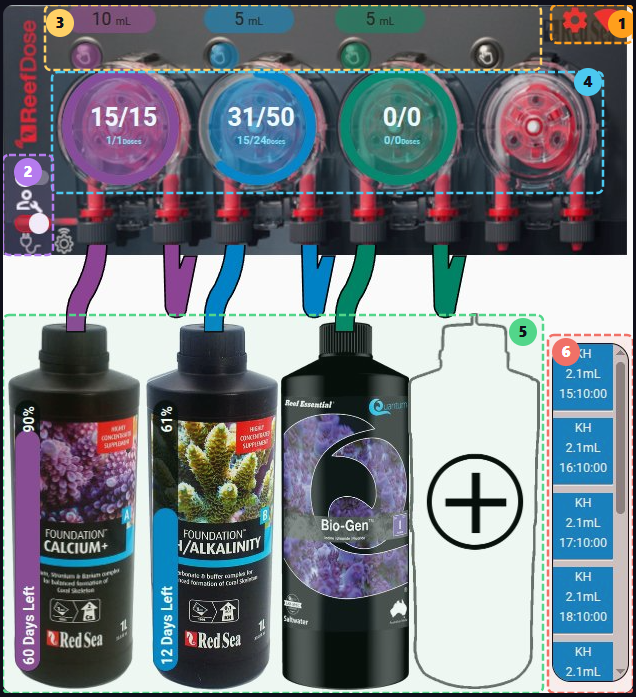

## Konfiguration/WLAN-Informationen

---

Klicken Sie auf das Symbol , um die allgemeine Konfiguration des ReefDose zu verwalten.

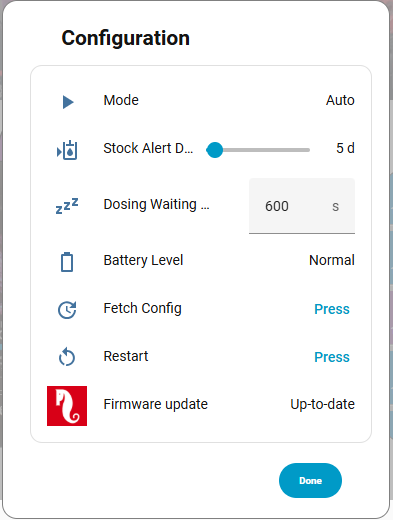

Klicken Sie auf das Symbol  um die Netzwerkeinstellungen zu verwalten.

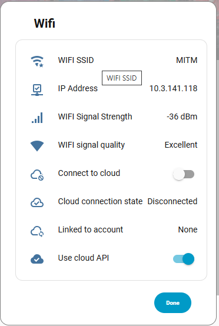

## Zustände

 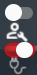

---

Der Wartungsschalter  ermöglicht den Wechsel in den Wartungsmodus.

 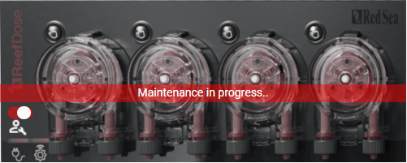

Der Ein/Aus-Schalter 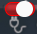 ermöglicht das Umschalten zwischen den Ein- und Aus-Zuständen des ReefDose.

 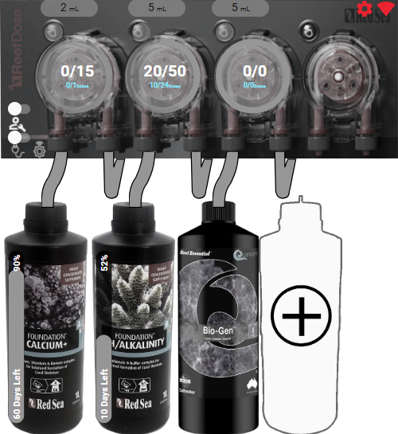

## Manuelle Dosierung

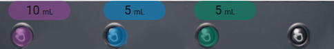

---

Die Schaltfläche  zeigt die Standard-Manualdosis für diesen Kopf an. Ein Klick öffnet das Konfigurationsfenster für diese Dosierung.

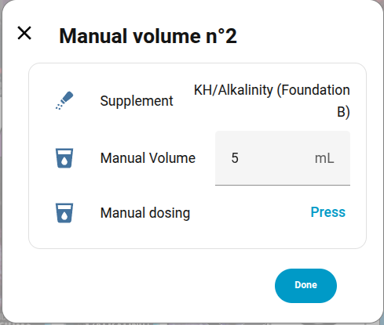

Sie können Verknüpfungen über den Karten-Editor hinzufügen:

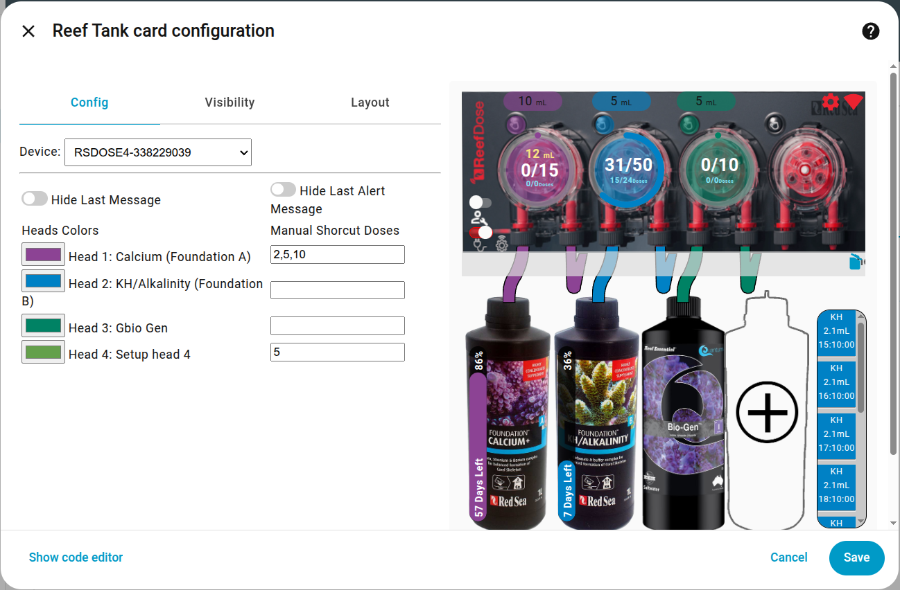

Zum Beispiel bietet Kopf 1 die Werte 2, 5 und 10 mL als Verknüpfungen an.

Diese Werte erscheinen oben im Dialogfeld. Ein Klick auf diese Verknüpfungen sendet einen Befehl zur Dosierung des definierten Wertes.

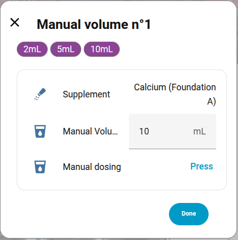

Ein Drücken der Taste für manuelle Dosierung:  sendet einen Dosierbefehl mit dem direkt darüber sichtbaren Standardwert: 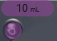, also 10 mL in diesem Beispiel.

## Konfiguration und Zeitplanung der Köpfe

 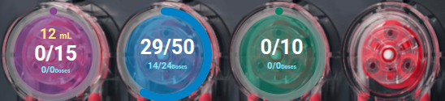

---

Dieser Bereich ermöglicht die Anzeige der aktuellen Kopfprogrammierung und deren Änderung.

- Der farbige Kreisring zeigt den prozentualen Anteil der bereits verabreichten Tagesdosis an.
- Die gelbe Zahl oben zeigt den kumulierten täglichen Manualdosis-Gesamtwert an.
- Der mittlere Teil zeigt das verteilte Volumen im Verhältnis zum insgesamt geplanten Tagesvolumen an.
- Der blaue untere Teil zeigt die Anzahl der verabreichten Dosen im Verhältnis zur Gesamtzahl der Tagesdosen an (Beispiel: 14/24 für Blau, da es eine stündliche Programmierung ist und dieser Screenshot um 14:15 Uhr aufgenommen wurde). Die Werte für Violett und Grün zeigen 0/0, da diese Dosen um 8 Uhr verteilt werden sollten, die Integration aber nach 8 Uhr gestartet wurde, sodass heute keine Dosen erfolgen werden.
- Ein langer Klick auf einen der 4 Köpfe schaltet diesen ein oder aus.
- Ein Klick auf einen Kopf öffnet das Programmierungsfenster.
  Von diesem Fenster aus können Sie eine Befüllung starten, den Kopf kalibrieren, die Tagesdosis und deren Planung ändern. Vergessen Sie nicht, die Programmierung zu speichern, bevor Sie das Fenster schließen.

  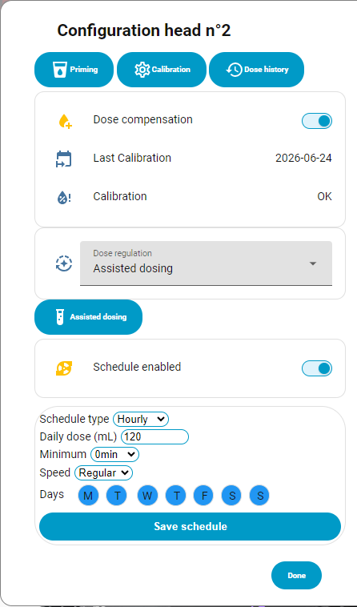

### Dosierregelung

Die Kopfkonfiguration enthält die **Dosierregelung** der [redsea-Integration](https://github.com/Elwinmage/ha-reefbeat-component/blob/main/doc/de/reefdose.de.md#dosierregelung):

- **Assistierte Dosierung**: Die Schaltfläche **Assistierte Dosierung** öffnet einen Dialog mit dem Diagramm Ihrer Testergebnisse, der Eingabe eines neuen Ergebnisses, der vorgeschlagenen Dosis zum Übernehmen oder Verwerfen und den Einstellungen der Berechnung. Nichts erreicht den Dosierer, bevor Sie es übernehmen.

  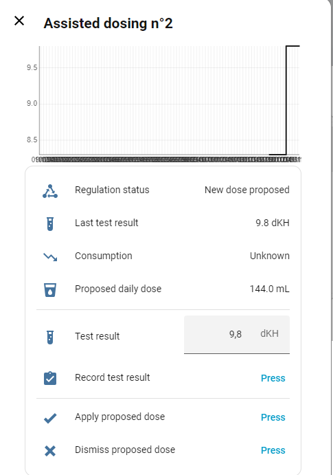 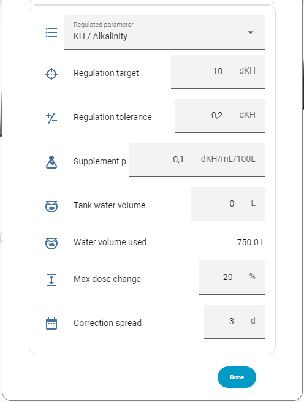

  Das Fenster zeigt die aktuelle Dosis (nur lesbar) direkt über der vorgeschlagenen. Ein Testergebnis wird von Hand eingegeben oder an der Spritze eines Testkits abgelesen: Kit wählen (Red Sea, Salifert, Colombo…) und die Reagenz-Ablesung in mL eingeben, das Ergebnis wird berechnet. Die Schaltfläche **Testergebnisse** listet die Ergebnisse, um eines mit einem früheren Datum hinzuzufügen, zu korrigieren oder zu löschen; das Diagramm folgt sofort. Ein Zusatz, den kein Test steuert (Red Sea NO3:PO4-X, Futter), bietet keine assistierte Dosierung, seine Wirksamkeit ist ausgegraut. Eine angewendete Dosis erscheint im Programm des Kopfes, wenn man dorthin zurückkehrt.

- **Salzlösung**: Der Kopf wird allein von Home Assistant mit manuellen Dosen gesteuert, daher zeigt seine Konfiguration statt des Programms die Salzlösung: Salinität der letzten Woche, Zustand und Alarm, geplante Salzlösung, Refraktometerprüfung und Einstellungen. In der Hauptansicht zeigen Ring und mittlere Beschriftung die heute dosierte gegenüber der geplanten Salzlösung, die untere Beschriftung die Salinität.

  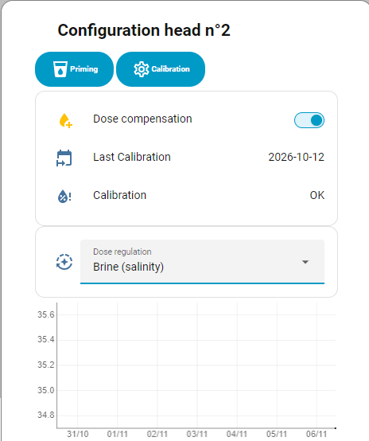 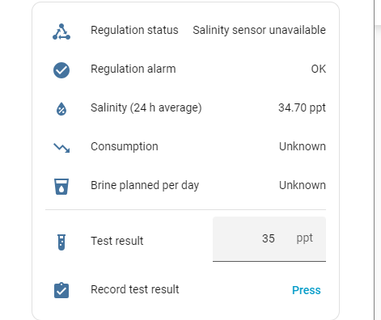 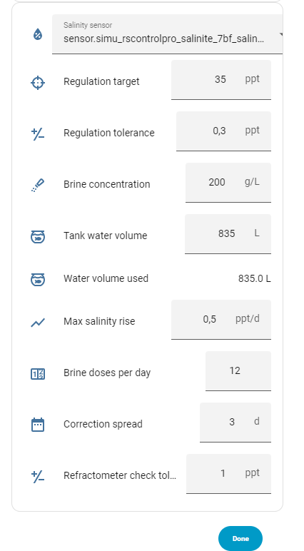

### Dosierverlauf

Solange der Dosierer im [Poseidon-Modus](https://github.com/Elwinmage/ha-reefbeat-component/blob/main/doc/de/poseidon.de.md#poseidon-modus) ist, hat die Kopfkonfiguration eine Schaltfläche **Dosierverlauf**: die Dosen des Kopfes, neueste zuerst, nach Tagen, mit Beginn, Ende, Dauer, Menge und Art (geplant, manuell, Kompensation). Letzte 24 h, 7 oder 31 Tage oder alles Gespeicherte, mit der Gesamtmenge des Zeitraums. Ein mit „≈“ markierter Beginn ist aus dem Durchfluss des Kopfes geschätzt.

## Verwaltung der Ergänzungsmittel

 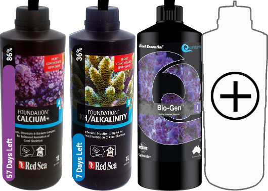

---

Dieser Bereich dient der Verwaltung der Ergänzungsmittel.
Wenn bereits ein Ergänzungsmittel deklariert ist, öffnet ein Klick darauf das Konfigurationsfenster, in dem Sie:

- Das Ergänzungsmittel löschen können (Papierkorb-Symbol oben rechts)
- Das Gesamtvolumen des Behälters angeben können
- Das tatsächliche Volumen des Ergänzungsmittels angeben können
- Entscheiden können, ob Sie das verbleibende Volumen verfolgen möchten. Ein Klick auf die Verknüpfungen oben aktiviert die Steuerung und setzt die Standardwerte mit einem vollen Behälter.
- Den Anzeigenamen des Ergänzungsmittels ändern können.

 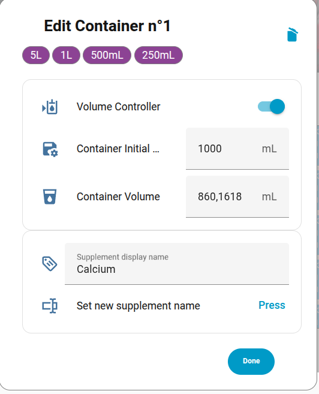

Wenn kein Ergänzungsmittel mit einem Kopf verknüpft ist, können Sie eines hinzufügen, indem Sie auf den Behälter mit einem '+' klicken (Kopf 4 in unserem Beispiel).

Folgen Sie dann den Anweisungen:

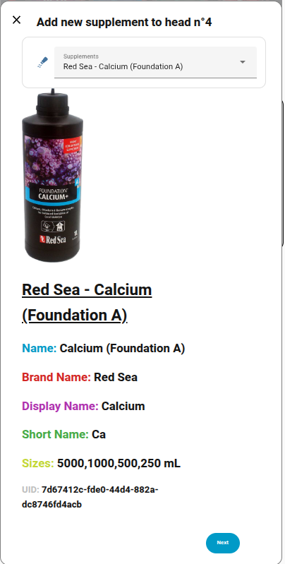

### Ergänzungsmittel

Hier ist die Liste der unterstützten Bilder für Ergänzungsmittel, nach Marke gruppiert. Wenn Ihres ein ❌ anzeigt, können Sie dessen Hinzufügung [hier](https://github.com/Elwinmage/reeftech-catalog/issues/new?labels=supplement) beantragen.

<b>ATI &nbsp; 2/2 🖼️</b>

<table>
<tr><td>✅</td><td>Essential Pro 1</td><td></td></tr>
<tr><td>✅</td><td>Essential Pro 2</td><td></td></tr>
</table>

<b>Aqua Forest &nbsp; 3/9 🖼️</b>

<table>
<tr><td>✅</td><td>Ca Plus</td><td></td></tr>
<tr><td>❌</td><td colspan='2'>Calcium </td></tr>
<tr><td>❌</td><td colspan='2'>Component 1+</td></tr>
<tr><td>❌</td><td colspan='2'>Component 2+</td></tr>
<tr><td>❌</td><td colspan='2'>Component 3+</td></tr>
<tr><td>❌</td><td colspan='2'>KH Buffer</td></tr>
<tr><td>✅</td><td>KH Plus</td><td></td></tr>
<tr><td>❌</td><td colspan='2'>Magnesium</td></tr>
<tr><td>✅</td><td>Mg Plus</td><td></td></tr>
</table>

<b>BRS &nbsp; 0/4 🖼️</b>

<table>
<tr><td>❌</td><td colspan='2'>Liquid Calcium</td></tr>
<tr><td>❌</td><td colspan='2'>Liquid alkalinity</td></tr>
<tr><td>❌</td><td colspan='2'>Magnesium Mix</td></tr>
<tr><td>❌</td><td colspan='2'>Part C</td></tr>
</table>

<b>Brightwell &nbsp; 0/12 🖼️</b>

<table>
<tr><td>❌</td><td colspan='2'>Calcion</td></tr>
<tr><td>❌</td><td colspan='2'>Ferrion</td></tr>
<tr><td>❌</td><td colspan='2'>Hydrate - MG</td></tr>
<tr><td>❌</td><td colspan='2'>KoralAmino</td></tr>
<tr><td>❌</td><td colspan='2'>Koralcolor</td></tr>
<tr><td>❌</td><td colspan='2'>Liquid Reef</td></tr>
<tr><td>❌</td><td colspan='2'>Potassion</td></tr>
<tr><td>❌</td><td colspan='2'>Reef Code A</td></tr>
<tr><td>❌</td><td colspan='2'>Reef Code B</td></tr>
<tr><td>❌</td><td colspan='2'>Replenish</td></tr>
<tr><td>❌</td><td colspan='2'>Restore</td></tr>
<tr><td>❌</td><td colspan='2'>Strontion</td></tr>
</table>

<b>DIY &nbsp; 1/1 🖼️</b>

<table>
<tr><td>✅</td><td>Brine</td><td></td></tr>
</table>

<b>ESV &nbsp; 0/5 🖼️</b>

<table>
<tr><td>❌</td><td colspan='2'>B-Ionic Component 1</td></tr>
<tr><td>❌</td><td colspan='2'>B-Ionic Component 2</td></tr>
<tr><td>❌</td><td colspan='2'>B-Ionic Magnesium</td></tr>
<tr><td>❌</td><td colspan='2'>Transition elements </td></tr>
<tr><td>❌</td><td colspan='2'>Transition elements plus</td></tr>
</table>

<b>Fauna Marine &nbsp; 0/11 🖼️</b>

<table>
<tr><td>❌</td><td colspan='2'>Amin</td></tr>
<tr><td>❌</td><td colspan='2'>Balling light  trace 1</td></tr>
<tr><td>❌</td><td colspan='2'>Balling light  trace 2</td></tr>
<tr><td>❌</td><td colspan='2'>Balling light  trace 3</td></tr>
<tr><td>❌</td><td colspan='2'>Balling light Ca</td></tr>
<tr><td>❌</td><td colspan='2'>Balling light KH</td></tr>
<tr><td>❌</td><td colspan='2'>Balling light Mg</td></tr>
<tr><td>❌</td><td colspan='2'>Blue trace elements</td></tr>
<tr><td>❌</td><td colspan='2'>Green trace elements</td></tr>
<tr><td>❌</td><td colspan='2'>Min S</td></tr>
<tr><td>❌</td><td colspan='2'>Red trace elements</td></tr>
</table>

<b>Quantum &nbsp; 7/7 🖼️</b>

<table>
<tr><td>✅</td><td>Aragonite A</td><td></td></tr>
<tr><td>✅</td><td>Aragonite B</td><td></td></tr>
<tr><td>✅</td><td>Aragonite C</td><td></td></tr>
<tr><td>✅</td><td>Bio Kalium</td><td></td></tr>
<tr><td>✅</td><td>Bio Metals</td><td></td></tr>
<tr><td>✅</td><td>Bio enhance</td><td></td></tr>
<tr><td>✅</td><td>Gbio Gen</td><td></td></tr>
</table>

<b>Red Sea &nbsp; 14/17 🖼️</b>

<table>
<tr><td>✅</td><td>Bio Active (Colors D)</td><td></td></tr>
<tr><td>✅</td><td>Calcium (Foundation A)</td><td></td></tr>
<tr><td>❌</td><td colspan='2'>Calcium (Powder)</td></tr>
<tr><td>✅</td><td>Iodine (Colors A)</td><td></td></tr>
<tr><td>✅</td><td>Iron (Colors C)</td><td></td></tr>
<tr><td>✅</td><td>KH/Alkalinity (Foundation B)</td><td></td></tr>
<tr><td>❌</td><td colspan='2'>KH/Alkalinity (Powder)</td></tr>
<tr><td>✅</td><td>Magnesium (Foundation C)</td><td></td></tr>
<tr><td>❌</td><td colspan='2'>Magnesium (Powder)</td></tr>
<tr><td>✅</td><td>NO3PO4-X</td><td></td></tr>
<tr><td>✅</td><td>Potassium (Colors B)</td><td></td></tr>
<tr><td>✅</td><td>Reef Energy Plus</td><td></td></tr>
<tr><td>✅</td><td>ReefCare Part 1: Calcium & Magnesium</td><td></td></tr>
<tr><td>✅</td><td>ReefCare Part 2: KH/Alkalinity &PH stabilizer</td><td></td></tr>
<tr><td>✅</td><td>ReefCare Part 3: Iodine & Potassium</td><td></td></tr>
<tr><td>✅</td><td>ReefCare Part 4: Iron & Bioactive elements</td><td></td></tr>
<tr><td>✅</td><td>ReefCare Program</td><td></td></tr>
</table>

<b>Seachem &nbsp; 0/9 🖼️</b>

<table>
<tr><td>❌</td><td colspan='2'>Reef Calcium</td></tr>
<tr><td>❌</td><td colspan='2'>Reef Carbonate</td></tr>
<tr><td>❌</td><td colspan='2'>Reef Complete</td></tr>
<tr><td>❌</td><td colspan='2'>Reef Fusion 1</td></tr>
<tr><td>❌</td><td colspan='2'>Reef Fusion 2</td></tr>
<tr><td>❌</td><td colspan='2'>Reef Iodine</td></tr>
<tr><td>❌</td><td colspan='2'>Reef Plus</td></tr>
<tr><td>❌</td><td colspan='2'>Reef Strontium</td></tr>
<tr><td>❌</td><td colspan='2'>Reef Trace</td></tr>
</table>

<b>Triton &nbsp; 0/4 🖼️</b>

<table>
<tr><td>❌</td><td colspan='2'>Core7 elements 1</td></tr>
<tr><td>❌</td><td colspan='2'>Core7 elements 2</td></tr>
<tr><td>❌</td><td colspan='2'>Core7 elements 3A</td></tr>
<tr><td>❌</td><td colspan='2'>Core7 elements 3B</td></tr>
</table>

<b>Tropic Marin &nbsp; 6/14 🖼️</b>

<table>
<tr><td>❌</td><td colspan='2'>A Element</td></tr>
<tr><td>✅</td><td>All-For-Reef</td><td></td></tr>
<tr><td>✅</td><td>Amino Organic</td><td></td></tr>
<tr><td>❌</td><td colspan='2'>Balling A</td></tr>
<tr><td>❌</td><td colspan='2'>Balling B</td></tr>
<tr><td>❌</td><td colspan='2'>Balling C</td></tr>
<tr><td>✅</td><td>Bio-Magnesium</td><td></td></tr>
<tr><td>✅</td><td>Carbo Calcium</td><td></td></tr>
<tr><td>❌</td><td colspan='2'>Elimi-NP</td></tr>
<tr><td>❌</td><td colspan='2'>K Element</td></tr>
<tr><td>❌</td><td colspan='2'>Liquid Buffer</td></tr>
<tr><td>✅</td><td>NP-Bacto-Balance</td><td></td></tr>
<tr><td>❌</td><td colspan='2'>Plus-NP</td></tr>
<tr><td>✅</td><td>Potassium</td><td></td></tr>
</table>

<!-- supplements:end -->

---

[← Zurück zur Hauptseite](README.de.md)
