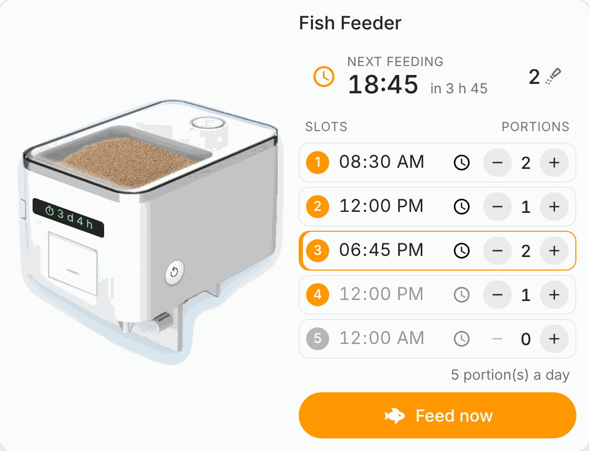
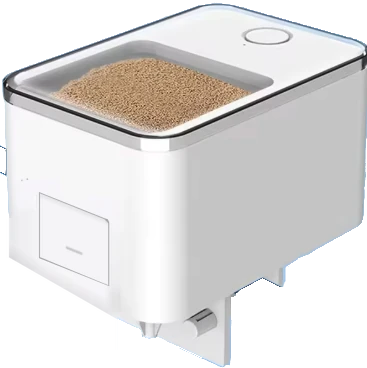
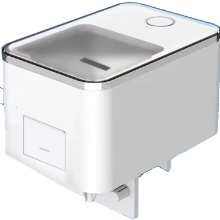
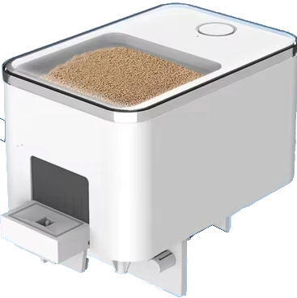
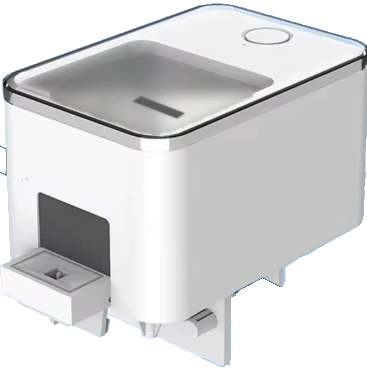
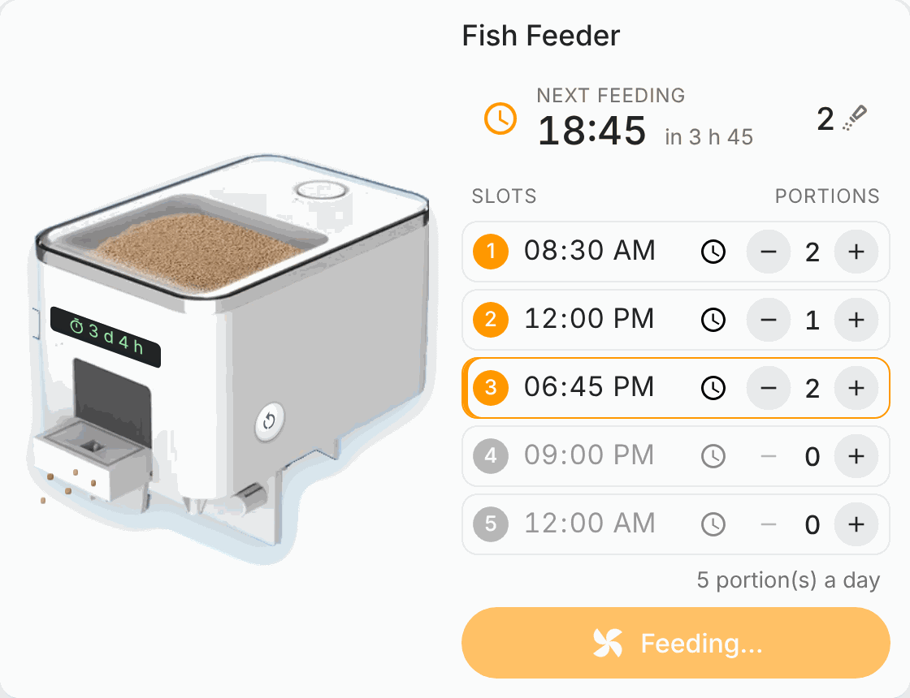
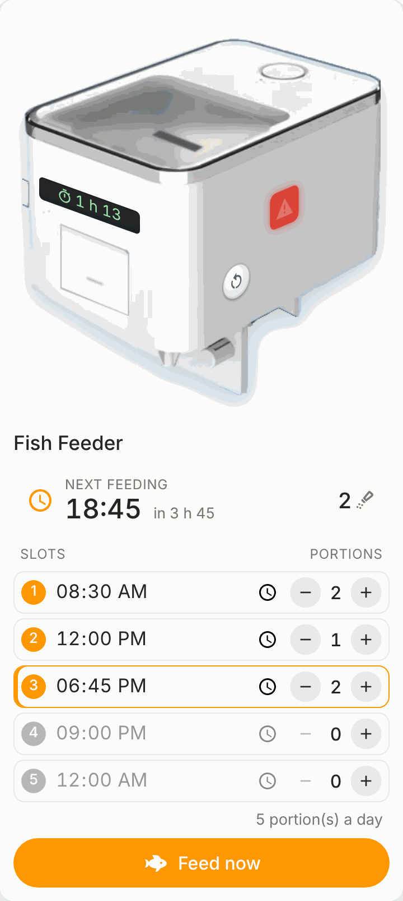

[← Back to the main page](../../README.md)

# Fish feeder VSON (hacked)

The card drives a VSON automatic fish feeder whose controller has been replaced by an ESP32 (Lolin S2 mini) running [ESPHome](https://esphome.io). The feeder keeps its motor, its trap sensor and its food level sensor; the firmware adds five feeding slots and a manual feed switch.



## Hacking the feeder

The feeder (VSON WP8621 V1.2) is opened and its original board replaced by an ESP32: wiring of the motor, the trap sensor and the food level sensor, and flashing, are explained in this Home Assistant community thread: [VSON WP8621 V1.2 fish feeder](https://community.home-assistant.io/t/vson-wp8621-v12-fish-feeder/759621).

## Firmware

The ESPHome configuration is in [doc/esphome/vson-fish-feeder.yaml](../esphome/vson-fish-feeder.yaml). Put your keys and passwords in `secrets.yaml` (`fish_feeder_api_key`, `fish_feeder_ota_password`, `fish_feeder_ap_password`, plus `wifi_ssid` and `wifi_password`).

ESPHome devices carry no identifier the card can rely on, so the feeder is recognised by the **project name** its firmware declares:

```yaml
esphome:
  project:
    name: "vson.fish_feeder"
    version: "1.2.0"
```

Home Assistant turns it into the manufacturer (`vson`) and the model (`fish_feeder`) of the device. Once flashed, the feeder appears in the device selector of the card. Any other ESPHome device is ignored.

The entities are found by the end of their entity id, so the device can be renamed freely. Keep the entity names of the firmware (`Manual Feed`, `Open/Close Sensor`, `Food Level Sensor`, `Slot 1`…`Slot 5`, `Portion slot 1`…`Portion slot 5`).

## The view

The card is divided into 2 zones:

1. The feeder
2. The feeding slots

### 1. The feeder

The picture follows the sensors:

|                 | Reserve OK                                                                 | Reserve low                                                                 |
| --------------- | -------------------------------------------------------------------------- | --------------------------------------------------------------------------- |
| **Trap closed** |  |  |
| **Trap open**   |    |    |

- While the trap is open (or the motor runs), pellets fall from it.
- Four things are stuck on the feeder, deformed to follow its faces:
  - on the front face, above the trap, a small display gives the **uptime** of the controller (a click opens the sensor);
  - on the glass of the lid, a red warning **blinks** when the food level sensor reports that the reserve is low (a click opens the sensor);
  - on the right face, the **feedings of the day**: struck through in grey once their hour has passed, the next one in orange, the later ones in green. Only the hours say which are past: the firmware keeps no record of the portions given;
  - lower on the right face, the **restart** button: a first tap arms it (it turns orange), a second tap within 3 seconds restarts the controller.
- A click on the picture opens the trap sensor.
- The  icon in the top right corner opens the maintenance tasks of the feeder, when it has any.



### 2. The feeding slots

- **Next feeding**: the hour of the next slot, the time left before it and its portions.
- **Slots**: the five slots of the firmware. The hour is edited in place (`time.set_value`), the portions with the − and + buttons (`number.set_value`, 0 to 10). A slot with 0 portions is off and greyed out. The next slot is highlighted.
- A slot set to the same hour as an earlier one is shown struck through: the firmware skips it while the first one is still feeding.
- **Portions a day**: the portions actually given in a day.
- **Feed now**: gives one portion (turns the `Manual Feed` switch on; the firmware turns it off once the trap has closed again).



When Home Assistant cannot reach the controller, the picture turns grey and the title says _Unreachable_.
