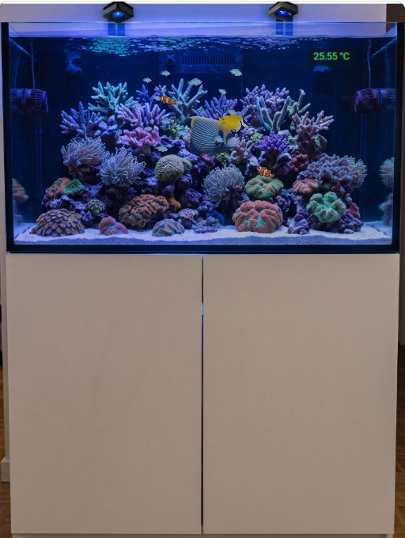
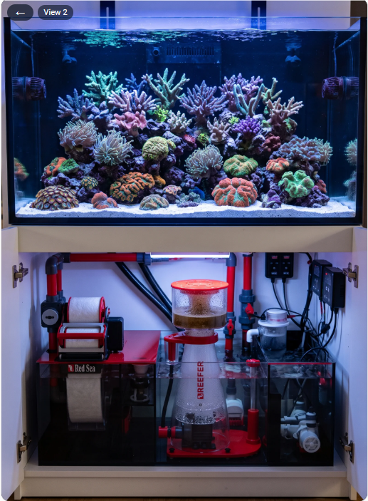

[← Torna alla pagina principale](README.it.md)

# Vista acquario

La vista acquario in azione:

[](https://www.youtube.com/watch?v=ZtYobmQZf9k)

Una seconda card, `custom:reef-aquarium-card`, mostra una foto della tua vasca con i suoi dispositivi ed entità, l'acqua illuminata dalle tue lampade e, se vuoi, pesci e coralli vivi. Richiede l'[integrazione ReefTank](https://github.com/Elwinmage/ha-reeftank-component), che conserva gli acquari e le loro immagini.

## La vista

 

Non ci sono zone fisse come nelle viste dei dispositivi: posiziona i tuoi dispositivi e le tue entità dove vuoi sulla tua immagine.

- **Immagine**: la foto della vista, o l'acqua disegnata, tinta dalle tue lampade a partire dal livello `light`.
- **Dispositivi ed entità**: un tocco su un dispositivo apre la sua vista in questa card; su un'entità, la sua azione abituale. Un dispositivo può anche essere contornato sull'immagine (rettangolo, lazo o poligono) invece di apparire come miniatura.
- **Zone cliccabili**: un tocco su una zona cliccabile apre un'altra vista dell'acquario (la sump nel mobile, per esempio); il pulsante ← torna alla precedente.

## Primi passi

1. Aggiungete una **Reef Aquarium Card** a una plancia (`custom:reef-aquarium-card`).
2. Nel suo editor, create un acquario (**Nuovo acquario**), poi **Modifica la scena**.
3. **Viste**: caricate una foto della vasca, contornate l'acqua, tracciate la linea della sabbia e le rocce.
4. **Dispositivi** e **Luce e corrente**: posate dispositivi ed entità sull'immagine, posizionate le lampade.
5. **Fauna**: aggiungete pesci e coralli, poi salvate.

La configurazione della scheda contiene solo l'id dell'acquario; tutto il resto è conservato dall'integrazione:

```yaml
type: custom:reef-aquarium-card
aquarium: a1b2 # chosen in the card editor
render: static # optional: static, light or full; can only lower the aquarium's level
view: front # optional: the view to start on
```

Con un account cloud ReefBeat, l'acquario del cloud precompila dimensioni, lampade e scorciatoie di alimentazione, e filtra i dispositivi Red Sea.

## L'editor di scena

Una finestra a schermo intero, aperta dall'editor della scheda, con sette schede:

### Acquario


Nome, dimensioni, l'acquario cloud corrispondente, luce con cui sono state scattate le foto, livello di resa, oscurità dell'acqua di notte.

- **Volume d'acqua netto (L)**: Vasca e sump, senza rocce né sabbia. Usato dalla regolazione del dosaggio della ReefDose. → [Regolazione del dosaggio](reefdose.it.md#regolazione-del-dosaggio)

### Viste


Le immagini; per ogni acqua: contorno, linea della sabbia (davanti e dietro), rocce e loro profondità, zone cliccabili, sfondo disegnato e sue texture.

- **Sabbia e rocce**: traccia la linea della sabbia contro il vetro frontale (e contro la parete di fondo quando l'immagine mostra la superficie della sabbia) e contorna le rocce con la loro profondità: i pesci restano sopra la sabbia, nuotano dietro le rocce e quelli di fondo vi strisciano sopra.
- **Arredo disegnato**: quando la foto dell'acqua non è utilizzabile, l'acqua può essere disegnata (acqua, sabbia, texture di roccia del catalogo), mantenendo il resto dell'immagine.

### Dispositivi


I vostri dispositivi ed entità per piano e area, trascinati sull'immagine.

Seleziona **Nascondi l'etichetta** per mostrare solo il valore e scegli il suo **Colore del testo**: l'etichetta resta nell'editor.

### Luce e corrente


Le lampade che illuminano ogni acqua e la loro posizione; le pompe che muovono l'acqua.

- **Anteprima della luce**: selezionala per provare una temperatura di colore (da 9.000 a 23.000 K, la gamma della ReefLED) e un'intensità sull'immagine. Nulla viene inviato alle lampade.

### Fauna


Pesci (specie, numero, taglia, rifugio) e coralli (specie, taglia, colori, posizione).

- **Comportamento**: banchi, nuotatori di acque libere, pesci di fondo, pesci che vivono attorno a un rifugio, ghiozzi che spuntano dalla tana; di notte i pesci si nascondono o riposano, sotto un velo che mantiene leggibile la vasca.
- **Specie**: pesci e coralli vengono dal [catalogo ReefTank](https://github.com/Elwinmage/reeftank-catalog), scaricato e aggiornato dall'integrazione. L'editor li elenca con una miniatura; un nome assente dal catalogo nuota come un pesce generico.

### Alimentazione


Le entità che registrano un'alimentazione, e dove cade il cibo.

- **Punti di alimentazione**: un dispositivo o un'entità della scheda **Dispositivi** può essere un punto di alimentazione, dove si radunano i pesci. Farlo con un alimentatore aggiunge anche la sua entità di alimentazione alle fonti e vi lega il punto; ogni fonte elenca i suoi punti.

### Monitoraggio


Le entità di pH, ORP, CO2 della stanza e test KH, ciò che segnala una calibrazione, le soglie degli allarmi e lo stato del monitoraggio.

Gli allarmi confrontano la vasca con la sua cronologia recente.

## Livelli di resa

Ogni acquario è reso a uno di tre livelli; una scheda può abbassarlo, ad esempio su un tablet a muro lento:

| Livello                | Mostra                          |
| ---------------------- | ------------------------------- |
| **Statico** (`static`) | immagine, dispositivi ed entità |
| **Luce** (`light`)     | più il colore delle lampade     |
| **Completo** (`full`)  | più pesci e coralli             |

Una foto del locale tecnico con i dispositivi in tempo reale è un ottimo acquario `static`.

La guida completa (editor di scena, entità, servizi, catalogo) è nel [README di ReefTank](https://github.com/Elwinmage/ha-reeftank-component/blob/main/doc/it/README.it.md).
