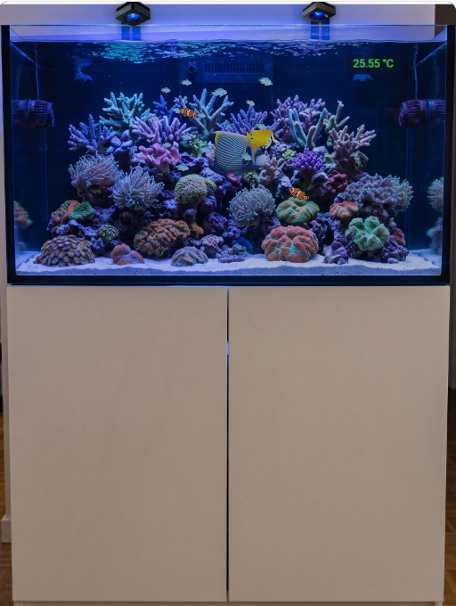
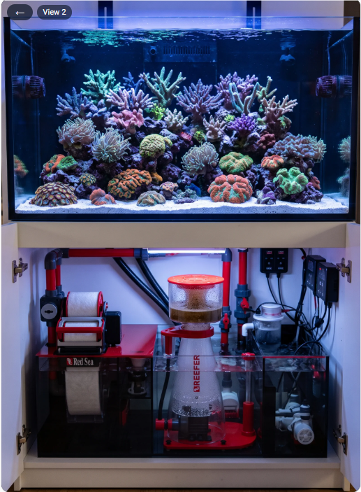

[← Powrót do strony głównej](README.pl.md)

# Widok akwarium

Druga karta, `custom:reef-aquarium-card`, pokazuje zdjęcie Twojego akwarium z urządzeniami i encjami, wodę oświetloną Twoimi lampami oraz, jeśli chcesz, żywe ryby i koralowce. Wymaga [integracji ReefTank](https://github.com/Elwinmage/ha-reeftank-component), która przechowuje akwaria i ich zdjęcia.

## Widok

 

Nie ma stałych stref jak w widokach urządzeń: umieszczasz urządzenia i encje w dowolnym miejscu na swoim obrazie.

- **Obraz**: zdjęcie widoku lub narysowana woda, zabarwiona przez Twoje lampy od poziomu `light`.
- **Urządzenia i encje**: dotknięcie urządzenia otwiera jego widok w tej karcie, a encji — jej zwykłą akcję. Urządzenie można też obrysować na zdjęciu (prostokąt, lasso lub wielokąt) zamiast pokazywać jako miniaturę.
- **Strefy klikalne**: dotknięcie klikalnej strefy otwiera inny widok akwarium (na przykład sump w szafce); przycisk ← wraca do poprzedniego.

## Pierwsze kroki

1. Dodaj **Reef Aquarium Card** do pulpitu (`custom:reef-aquarium-card`).
2. W jej edytorze utwórz akwarium (**Nowe akwarium**), następnie **Edytuj scenę**.
3. **Widoki**: prześlij zdjęcie zbiornika, obrysuj wodę, wyznacz linię piasku i skały.
4. **Urządzenia** i **Światło i przepływ**: umieść urządzenia i encje na obrazie, ustaw lampy.
5. **Obsada**: dodaj ryby i koralowce, potem zapisz.

Konfiguracja karty zawiera tylko id akwarium; resztę przechowuje integracja:

```yaml
type: custom:reef-aquarium-card
aquarium: a1b2 # chosen in the card editor
render: static # optional: static, light or full; can only lower the aquarium's level
view: front # optional: the view to start on
```

Z kontem chmury ReefBeat akwarium z chmury wstępnie wypełnia wymiary, lampy i skróty karmienia oraz filtruje urządzenia Red Sea.

## Edytor sceny

Pełnoekranowe okno, otwierane z edytora karty, z siedmioma zakładkami:

### Akwarium


Nazwa, wymiary, odpowiadające akwarium w chmurze, światło, przy którym zrobiono zdjęcia, poziom renderowania, ciemność wody w nocy.

- **Objętość wody netto (L)**: Zbiornik i sump, bez skał i piasku. Używana przez regulację dozowania ReefDose. → [Regulacja dozowania](reefdose.pl.md#regulacja-dozowania)

### Widoki


Obrazy; dla każdej wody: obrys, linia piasku (przód i tył), skały i ich głębokość, strefy klikalne, rysowane tło i jego tekstury.

- **Piasek i skały**: narysuj linię piasku przy przedniej szybie (i przy tylnej ścianie, gdy zdjęcie pokazuje powierzchnię piasku) i obrysuj skały wraz z ich głębokością: ryby trzymają się nad piaskiem, pływają za skałami, a gatunki denne po nim pełzają.
- **Rysowany wystrój**: gdy zdjęcia wody nie da się użyć, wodę można narysować (woda, piasek, tekstury skał z katalogu), zachowując resztę zdjęcia.

### Urządzenia


Twoje urządzenia i encje według pięter i obszarów, przeciągane na obraz.

Zaznacz **Ukryj etykietę**, aby wyświetlać tylko wartość, i wybierz **Kolor tekstu**: etykieta pozostaje w edytorze.

### Światło i przepływ


Lampy oświetlające każdą wodę i ich położenie; pompy poruszające wodę.

- **Podgląd światła**: zaznacz go, aby wypróbować na obrazie temperaturę barwową (od 9000 do 23 000 K, zakres ReefLED) i natężenie. Nic nie jest wysyłane do lamp.

### Obsada


Ryby (gatunek, liczba, rozmiar, schronienie) i koralowce (gatunek, rozmiar, kolory, położenie).

- **Zachowanie**: ławice, pływaki otwartej wody, gatunki denne, ryby żyjące wokół kryjówki, babki wyglądające z nory; nocą ryby chowają się lub odpoczywają, pod zasłoną, która utrzymuje czytelność akwarium.
- **Gatunki**: ryby i koralowce pochodzą z [katalogu ReefTank](https://github.com/Elwinmage/reeftank-catalog), pobieranego i aktualizowanego przez integrację. Edytor pokazuje je z miniaturą; nazwa spoza katalogu pływa jako ryba ogólna.

### Karmienie


Encje rejestrujące karmienie i miejsce, gdzie spada pokarm.

- **Punkty karmienia**: urządzenie lub encja z zakładki **Urządzenia** może być punktem karmienia, w którym gromadzą się ryby. Ustawienie karmnika jako punktu dodaje też jego encję karmienia do źródeł i wiąże z nią punkt; każde źródło wyświetla swoje punkty.

### Monitorowanie


Encje pH, ORP, CO2 w pomieszczeniu i testów KH, to, co sygnalizuje kalibrację, progi alarmów oraz stan monitorowania.

Alarmy porównują akwarium z jego własną niedawną historią.

## Poziomy renderowania

Każde akwarium jest wyświetlane na jednym z trzech poziomów; karta może go obniżyć, np. na wolnym tablecie ściennym:

| Poziom                   | Pokazuje                  |
| ------------------------ | ------------------------- |
| **Statyczny** (`static`) | obraz, urządzenia i encje |
| **Światło** (`light`)    | plus kolor lamp           |
| **Pełny** (`full`)       | plus ryby i koralowce     |

Zdjęcie pomieszczenia technicznego z urządzeniami na żywo to pełnoprawne akwarium `static`.

Pełny przewodnik (edytor sceny, encje, usługi, katalog) znajduje się w [README ReefTank](https://github.com/Elwinmage/ha-reeftank-component/blob/main/doc/pl/README.pl.md).
