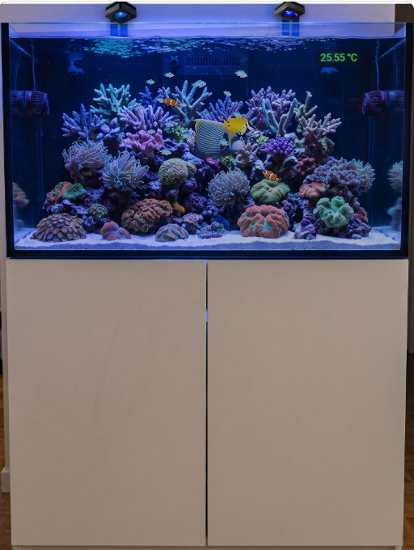
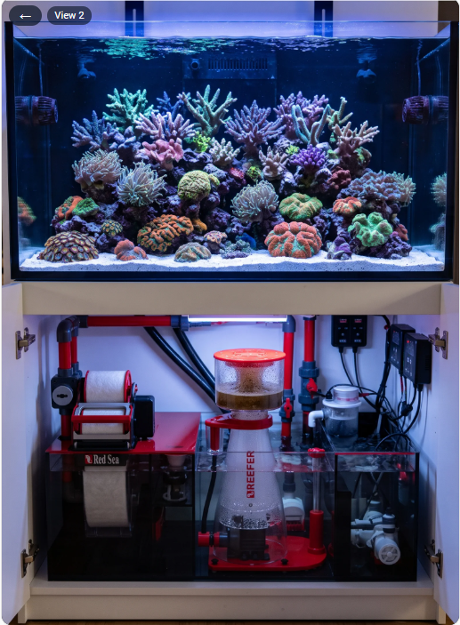
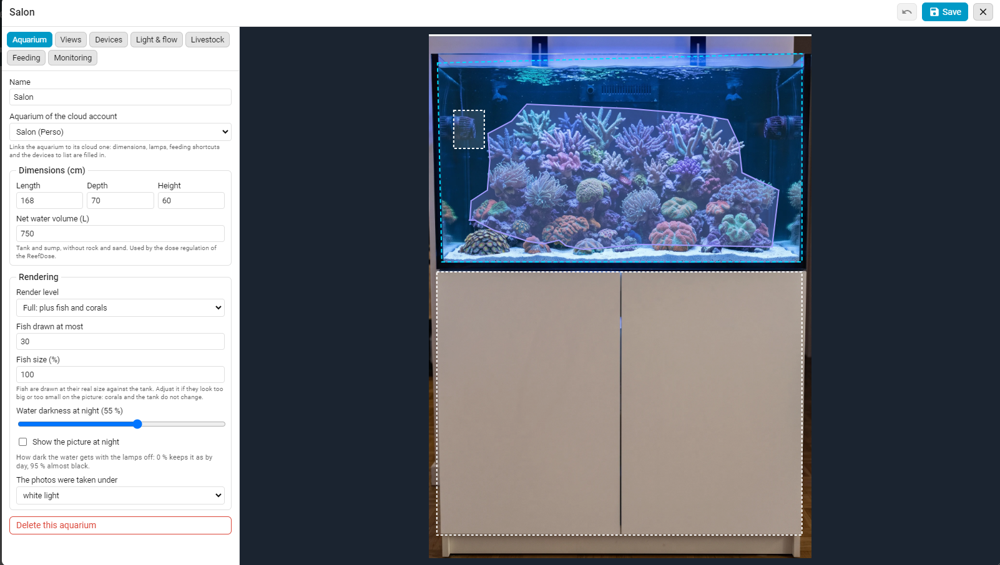
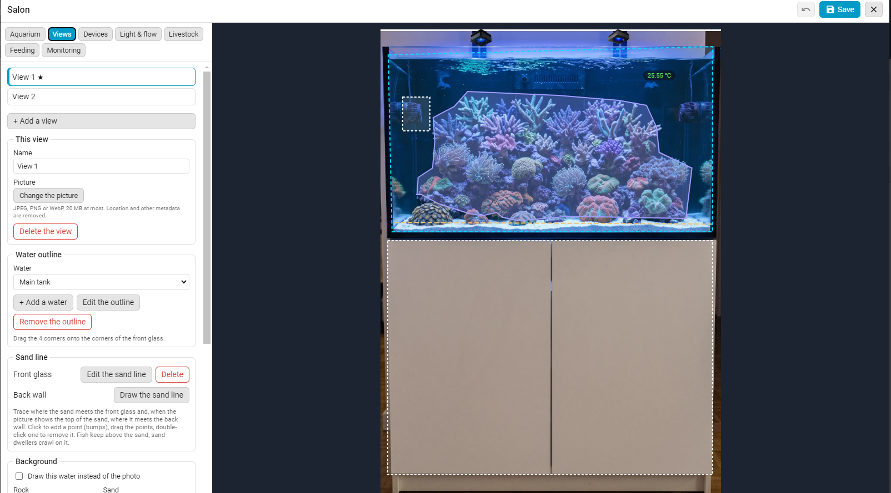
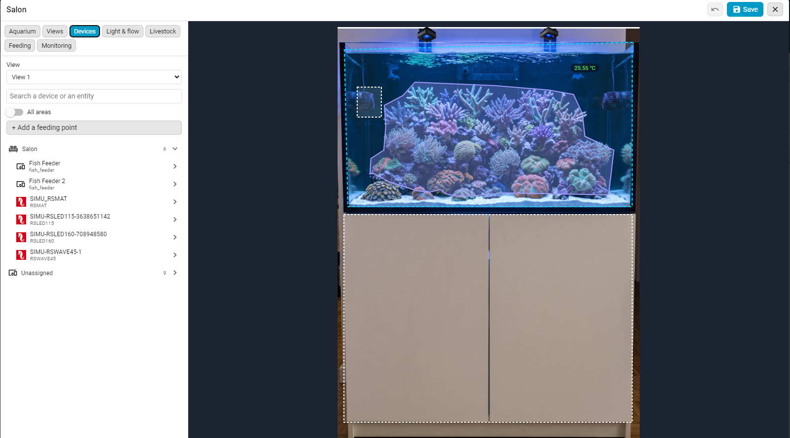
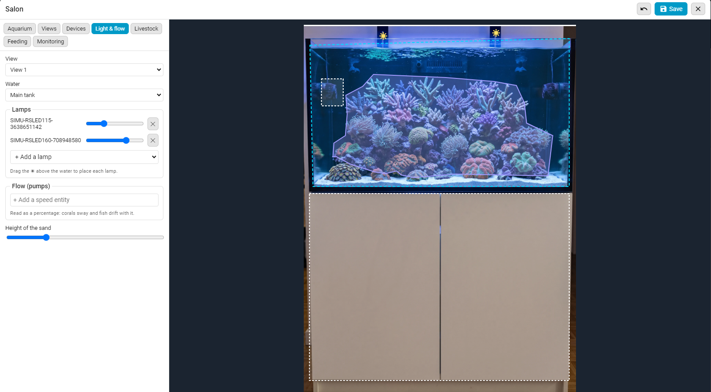
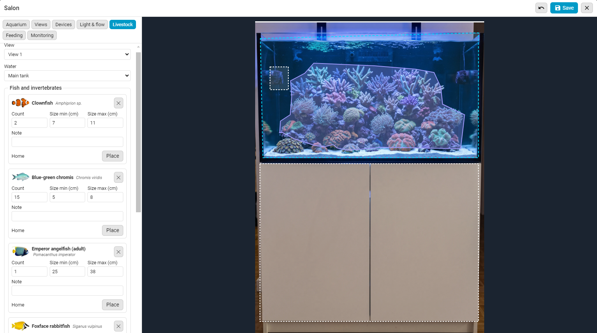
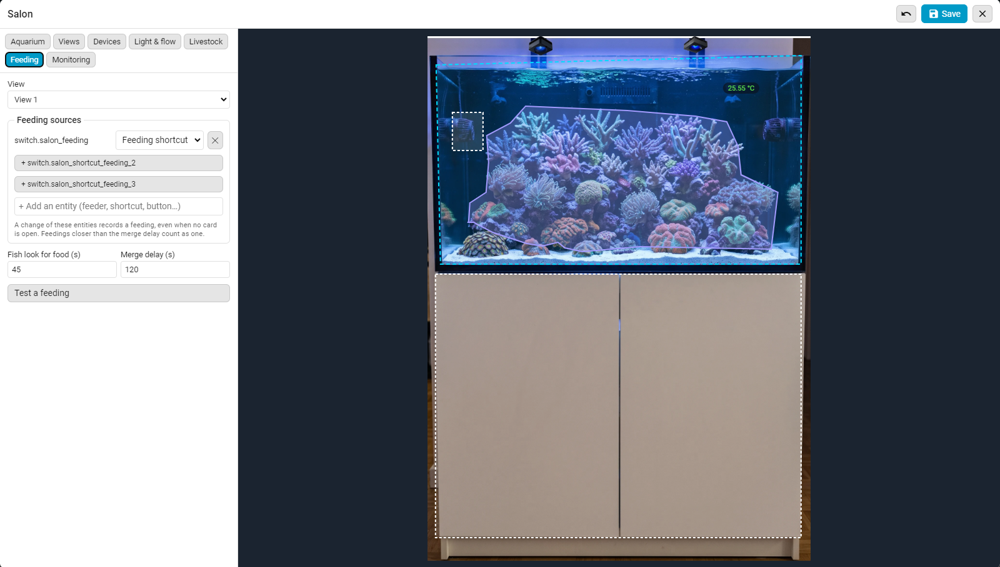
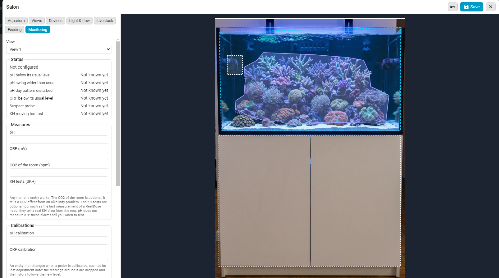

[← Voltar à página principal](README.pt.md)

# Vista de aquário

A vista de aquário em ação:

[](https://www.youtube.com/watch?v=ZtYobmQZf9k)

Um segundo cartão, `custom:reef-aquarium-card`, mostra uma foto do seu aquário com os dispositivos e entidades, a água iluminada pelas suas lâmpadas e, se quiser, peixes e corais vivos. Precisa da [integração ReefTank](https://github.com/Elwinmage/ha-reeftank-component), que guarda os aquários e as suas imagens.

## A vista

 

Não há zonas fixas como nas vistas dos dispositivos: coloque os seus dispositivos e entidades onde quiser na sua imagem.

- **Imagem**: a foto da vista, ou a água desenhada, tingida pelas suas lâmpadas a partir do nível `light`.
- **Dispositivos e entidades**: um toque num dispositivo abre a sua vista neste cartão; numa entidade, a sua ação habitual. Um dispositivo também pode ser contornado na imagem (retângulo, laço ou polígono) em vez de aparecer como miniatura.
- **Zonas clicáveis**: um toque numa zona clicável abre outra vista do aquário (a sump no móvel, por exemplo); o botão ← volta à anterior.

## Primeiros passos

1. Adicione um **Reef Aquarium Card** a um painel (`custom:reef-aquarium-card`).
2. No seu editor, crie um aquário (**Novo aquário**) e depois **Editar a cena**.
3. **Vistas**: envie uma foto do aquário, contorne a água, trace a linha da areia e as rochas.
4. **Dispositivos** e **Luz e corrente**: coloque os seus dispositivos e entidades na imagem, posicione as lâmpadas.
5. **Fauna**: adicione os seus peixes e corais e guarde.

A configuração do cartão só contém o id do aquário; tudo o resto é guardado pela integração:

```yaml
type: custom:reef-aquarium-card
aquarium: a1b2 # chosen in the card editor
render: static # optional: static, light or full; can only lower the aquarium's level
view: front # optional: the view to start on
```

Com uma conta cloud ReefBeat, o aquário da cloud preenche dimensões, lâmpadas e atalhos de alimentação, e filtra os dispositivos Red Sea.

## O editor de cena

Uma janela em ecrã inteiro, aberta a partir do editor do cartão, com sete separadores:

### Aquário



Nome, dimensões, o aquário da nuvem correspondente, luz com que as fotos foram tiradas, nível de renderização, escuridão da água à noite.

- **Volume de água líquido (L)**: Aquário e sump, sem rochas nem areia. Usado pela regulação da dosagem da ReefDose. → [Regulação da dosagem](reefdose.pt.md#regulação-da-dosagem)

### Vistas



As imagens; para cada água: contorno, linha da areia (frente e fundo), rochas e a sua profundidade, zonas clicáveis, fundo desenhado e as suas texturas.

- **Areia e rochas**: trace a linha de areia contra o vidro frontal (e contra a parede do fundo quando a imagem mostra a superfície da areia) e contorne as rochas com a sua profundidade: os peixes mantêm-se acima da areia, nadam atrás das rochas e os de fundo rastejam sobre ela.
- **Decoração desenhada**: quando a foto da água não é utilizável, a água pode ser desenhada (água, areia, texturas de rocha do catálogo), mantendo o resto da imagem.

### Dispositivos



Os seus dispositivos e entidades por piso e divisão, arrastados para a imagem.

Marque **Ocultar a etiqueta** para mostrar apenas o valor e escolha a **Cor do texto**: a etiqueta mantém-se no editor.

### Luz e corrente



As lâmpadas que iluminam cada água e a sua posição; as bombas que movem a água.

- **Pré-visualização da luz**: marque-a para experimentar uma temperatura de cor (de 9.000 a 23.000 K, a gama da ReefLED) e uma intensidade na imagem. Nada é enviado às lâmpadas.

### Fauna



Peixes (espécie, número, tamanho, abrigo) e corais (espécie, tamanho, cores, posição).

- **Comportamento**: cardumes, nadadores de águas abertas, peixes de fundo, peixes que vivem à volta de um refúgio, gobídeos a espreitar da toca; à noite os peixes escondem-se ou descansam, sob um véu que mantém o aquário legível.
- **Espécies**: peixes e corais vêm do [catálogo ReefTank](https://github.com/Elwinmage/reeftank-catalog), descarregado e mantido atualizado pela integração. O editor lista-os com uma miniatura; um nome fora do catálogo nada como um peixe genérico.

### Alimentação



As entidades que registam uma alimentação, e onde cai a comida.

- **Pontos de alimentação**: um dispositivo ou uma entidade do separador **Dispositivos** pode ser um ponto de alimentação, onde os peixes se juntam. Fazer isso com um alimentador acrescenta também a sua entidade de alimentação às fontes e liga o ponto a ela; cada fonte lista os seus pontos.

### Monitorização



As entidades de pH, ORP, CO2 da divisão e testes de KH, o que indica uma calibração, os limites dos alarmes e o estado da monitorização.

Os alarmes comparam o aquário com o seu próprio histórico recente.

## Níveis de renderização

Cada aquário é mostrado num de três níveis; um cartão pode baixá-lo, por exemplo num tablet de parede lento:

| Nível                   | Mostra                           |
| ----------------------- | -------------------------------- |
| **Estático** (`static`) | imagem, dispositivos e entidades |
| **Luz** (`light`)       | mais a cor das lâmpadas          |
| **Completo** (`full`)   | mais peixes e corais             |

Uma foto da sala técnica com os dispositivos em direto é um aquário `static` perfeitamente válido.

O guia completo (editor de cena, entidades, serviços, catálogo) está no [README do ReefTank](https://github.com/Elwinmage/ha-reeftank-component/blob/main/doc/pt/README.pt.md).
